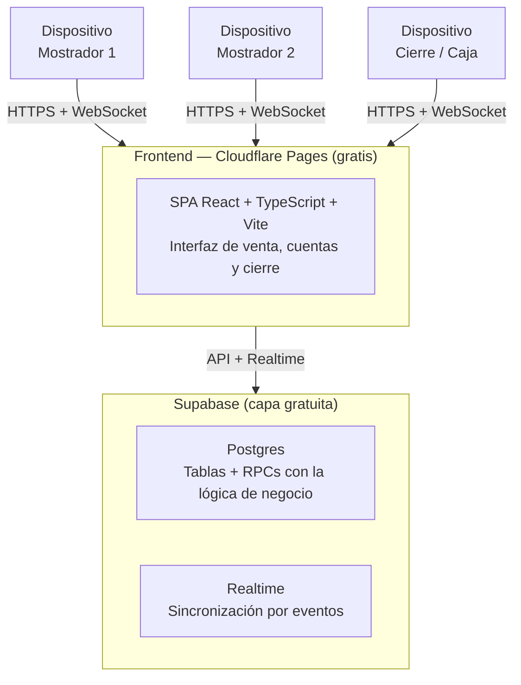

# Análisis y Arquitectura — Sistema Web de Gestión para Venta de Fritanga

> **Proyecto:** Fritanga tradicional en Cali, Colombia
> **Objetivo:** Agilizar la atención en mostrador con un solo operador y permitir hasta 3 dispositivos sincronizados en tiempo real
> **Restricción:** Solución 100% gratuita ($0 de costo mensual)
> **Stack:** TypeScript (React + Vite) + SQL (Supabase) — sin backend propio

---

## 1. Resumen ejecutivo

| Campo | Definición |
|---|---|
| Negocio | Fritanga en Cali — empanadas, papas rellenas, marranitas, café, café con leche, gaseosa |
| Problema | Caos en horas pico con **1 operador principal** en mostrador |
| Objetivo | Agilizar la atención + operación concurrente de hasta **3 dispositivos sincronizados en tiempo real** |
| Restricción dura | **$0 de costo mensual** (hosting + BD en capas gratuitas) |
| Perfil del desarrollador | Experiencia en .NET → código tipado, limpio y con lógica de negocio centralizada |

### Criterios de éxito

- Una venta se registra en menos de 3 segundos.
- El inventario nunca queda negativo aunque 2 dispositivos vendan a la vez.
- El cuadre de caja cuadra matemáticamente (fórmula exacta, sin sorpresas).
- Las 3 pantallas reflejan los cambios en menos de 1 segundo.

---

## 2. Alcance y análisis de requisitos

### 2.1 Actores

| Actor | Rol |
|---|---|
| **Operador de mostrador** (1–3 concurrentes, sin login) | Vende, abre/cobra cuentas, agrega productos |
| **Responsable de cierre** (rol por convención, no técnico) | Abre turno con base de caja, cierra con conteo físico y revisa reportes |

### 2.2 Catálogo base de productos

Empanadas · Papas rellenas · Marranitas · Café · Café con leche · Gaseosa

### 2.3 Requisitos funcionales analizados

#### RF1 — Base inicial de caja
- Al iniciar turno se registra una base física (**default $70.000 COP** para cambio).
- Regla: **solo puede existir un turno abierto a la vez** → apertura atómica (si ya hay turno abierto, la siguiente apertura falla).
- La base es **fija por turno**; no se edita después de abrir (integridad del cuadre).

#### RF2 — Inventario exacto y concurrente
- Carga inicial por producto al abrir turno (ej. 100 empanadas) → conteo inicial **por turno**, no global.
- Stock teórico = `inicial − Σ vendidos` → se **deriva**, nunca se almacena como contador mutable (imposible desincronizar).
- Descuento automático **solo mediante RPC transaccional** (ver sección 4). Nunca `UPDATE` desde el cliente.
- Sincronía instantánea vía Supabase Realtime en los 3 dispositivos.
- **Corte y merma:** `merma = teórico − conteo físico` al finalizar el día.

#### RF3 — Cuentas abiertas
- Crear pestaña con etiqueta libre ("Mesa 1", "Cliente con chaqueta").
- Agregar ítems de forma acumulativa: cada alta es una venta vinculada a la cuenta, con descuento de inventario **en ese momento** (el stock nunca se "promete" sin descontar).
- Listado global de cuentas activas con total en vivo.
- Cobro al cerrar: total → efectivo recibido → vuelto → cuenta pasa a `cerrada`.
- **Regla:** solo una cuenta *abierta* con la misma etiqueta por turno (evita duplicados por error táctil).

#### RF4 — Venta rápida (mostrador)
- Grid de botones grandes con producto + precio + **stock visible** (agotado = deshabilitado).
- Teclado de efectivo con denominaciones rápidas $2.000 / $5.000 / $10.000 / $20.000 / $50.000 → vuelto instantáneo `recibido − total`.
- Atajo "EXACTO" (paga sin vuelto).

#### RF5 — Cierre de caja y reportes
- Fórmula oficial:

```
Dinero Esperado = Base Inicial + Ventas Totales en Efectivo − Retiros/Salidas
```

- Comparación `esperado vs conteo físico` → **faltante o sobrante**.
- Reporte del turno: ventas por producto, por método (efectivo directo vs cobro de cuenta) y merma por producto.

### 2.4 Fórmulas oficiales

```
Vuelto            = Recibido − Total
Stock teórico     = Inicial turno − Vendidos
Dinero Esperado   = Base Inicial + Ventas en efectivo − Retiros + Entradas
Diferencia caja   = Conteo físico − Dinero Esperado   (negativo = faltante)
Merma producto    = Stock teórico − Conteo físico
```

### 2.5 Fuera de alcance (explícito)

Facturación electrónica DIAN · multi-sede · crédito/pagaré · modo offline · apps nativas · roles/permisos finos.

---

## 3. Arquitectura técnica



### 3.1 Tabla de decisiones

| Necesidad | Elegido | Alternativas descartadas | Por qué |
|---|---|---|---|
| Frontend | React + TypeScript + Vite | Blazor WASM, Next.js | SPA estática ligera; TS tipado ≈ C#; Next.js aporta serverless innecesario (la lógica vive en la BD) |
| Hosting | Cloudflare Pages | Vercel, Netlify | Assets estáticos ilimitados, deploy por git |
| BD + realtime | Supabase | Firebase, Neon | Postgres = SQL para cuadre y mermas; Realtime incluido; Neon exigiría servidor WebSocket propio (rompe los $0) |
| Lógica de negocio | **RPCs SQL** | Lógica en el cliente | Atomicidad real ante concurrencia (sección 4) |
| Sincronización | `postgres_changes` por tabla | Polling, Broadcast manual | El evento lo emite la propia BD → fuente única de verdad, latencia < 1 s |
| Acceso | Sin login (decisión propia) | PIN, Supabase Auth | Fricción cero en mostrador; riesgo mitigado en sección 8 |

---

## 4. Estrategia de concurrencia (riesgo principal)

**Riesgo:** 2 dispositivos venden la última empanada al mismo tiempo → stock −1 y una venta fantasma.

**Solución — transacción atómica en la base de datos:**

```
fn_registrar_venta(items[], recibido):
  INICIO;
    bloquear la fila del turno abierto   -- SELECT ... FOR UPDATE
      (punto único de serialización: 2 ventas simultáneas
       se atienden una tras otra, nunca en paralelo)
    validar stock >= cantidad de cada ítem
      (stock = conteo_inicial − vendidos, se DERIVA)
    INSERTAR venta + detalles
  FIN;
  → retorna { venta_id, total, vuelto } o error "STOCK_INSUFICIENTE"
```

- Un solo viaje; **o se vende todo, o no se vende nada**.
- Si falla por stock, la pantalla muestra "agotado" y Realtime ya refrescó el inventario en las 3 pantallas.
- **Los clientes nunca hacen `UPDATE` de stock** — solo leen y llaman RPCs.

### Flujo de sincronización

```
Dispositivo A ──RPC──▶ Postgres confirma ──evento──▶ Dispositivos B y C
                                                     (< 1 s, sin polling)
```

### Concurrencia de cuentas abiertas

Mismo patrón: `fn_agregar_a_cuenta` valida `estado='abierta'` dentro de la transacción; el cobro final bloquea la cuenta para que **un solo dispositivo** pueda cobrarla (el segundo recibe "ya fue cobrada").

### Tolerancia a fallos de red

- UI optimista + indicador "registrando…"; el estado confirmado solo llega desde el servidor.
- Reintento idempotente con `client_tx_id` (UUID generado por el cliente): si el WebSocket se cae y se reintenta, **no se duplica la venta**.

---

## 5. Modelo de datos

Ver [`mer-tecnico.md`](./mer-tecnico.md) para el diagrama completo y el diccionario de atributos.

Resumen de entidades:

| Entidad | Qué representa |
|---|---|
| `ajustes` | Parámetros globales (base por defecto $70.000, zona horaria) |
| `producto` | Catálogo de productos con precios |
| `turno` | Jornada: apertura con base de caja y cierre con conteo |
| `conteo_inicial` | Stock real de arranque por producto, por turno |
| `cuenta` | Cuenta abierta por cliente/mesa (RF3) |
| `venta` | Cobro realizado (directo o de cuenta) |
| `detalle_venta` | Ítems de cada venta |
| `movimiento_caja` | Retiros y entradas de efectivo |
| `reconciliacion` | Teórico vs físico por producto al cierre (mermas) |

**Notas de diseño:**
- Todo el dinero en **enteros COP** (sin decimales, sin números flotantes).
- Fechas en UTC; los reportes diarios se calculan en `America/Bogota`.
- El stock teórico **nunca se guarda**: se calcula al vuelo desde conteo inicial y ventas.

---

## 6. Especificación de RPCs (contratos)

| RPC | Entrada | Efecto | Errores |
|---|---|---|---|
| `fn_abrir_turno` | `base_cop, conteos[{producto_id, cantidad}]` | Crea turno `abierto` + conteos iniciales. Transaccional | `TURNO_YA_ABIERTO` |
| `fn_crear_cuenta` | `etiqueta, operador` | Crea o devuelve la cuenta abierta con esa etiqueta en el turno actual | `TURNO_CERRADO`, `ETIQUETA_VACIA` |
| `fn_registrar_venta` | `items[{producto_id, cantidad}], recibido_cop, client_tx_id, cuenta_id?` | Valida y descuenta stock, inserta venta (+ítems) o la acumula a una cuenta; retorna `total, vuelto` | `TURNO_CERRADO`, `STOCK_INSUFICIENTE`, `CUENTA_CERRADA` |
| `fn_cobrar_cuenta` | `cuenta_id, recibido_cop, client_tx_id` | Marca cuenta `cerrada`, genera venta tipo cobro por el total, calcula vuelto | `CUENTA_YA_COBRADA`, `RECIBIDO_INSUFICIENTE` |
| `fn_movimiento_caja` | `tipo, monto_cop, concepto` | Registra retiro/entrada en el turno abierto | `TURNO_CERRADO` |
| `fn_cerrar_turno` | `conteos_fisicos[{producto_id, cantidad}], efectivo_fisico_cop, notas` | Calcula teóricos, mermas, dinero esperado y diferencia; cierra turno. Transaccional | `TURNO_YA_CERRADO` |

**Vista de reportes:** `v_reporte_turno` → ventas por producto, totales en efectivo, retiros, mermas y diferencia; la pantalla de cierre hace una sola consulta.

---

## 7. Mapa de UI/UX (7 pantallas)

```
[0] Bienvenida       → nombre del operador (texto libre, guardado en el dispositivo)
[1] Apertura turno   → base $70.000 (editable) + conteo inicial por producto
                        ⚠ bloquea si ya hay turno abierto (muestra quién lo abrió)
[2] Venta rápida ★   → grid de botones (nombre, precio, stock)
                        + teclado numérico + denominaciones + vuelto en vivo
                        + [→ Cuenta] envía a cuenta abierta en vez de cobrar
[3] Cuentas abiertas → tarjetas con etiqueta, # ítems, total vivo, botón COBRAR
                        → detalle: agregar ítems acumulativos, cerrar cobro
[4] Inventario       → teórico vs vendido, estado por producto (solo lectura
                        en horas pico; edición solo al abrir/cerrar turno)
[5] Cierre de caja   → pasos: conteo físico por producto → conteo de efectivo
                        → resumen: Esperado / Físico / Diferencia / Mermas
[6] Reportes         → turno actual + histórico (ventas por producto, por hora)
```

### Principios para horas pico

- Objetivos táctiles ≥ 56 px; el grid de venta es la pantalla raíz tras abrir turno.
- Botones de denominación + "EXACTO" → vuelto visible, grande y en verde.
- Producto agotado se deshabilita en tiempo real en los 3 dispositivos.
- El cierre de caja vive en una pestaña aparte para no estorbar al operador.
- Mobile-first (los 3 dispositivos probablemente sean celulares/tablets); "añadir a pantalla de inicio" como app.

---

## 8. Seguridad con acceso abierto (riesgo asumido + mitigaciones)

Se eligió **sin login** → cualquiera con la URL podría operar. Mitigaciones sin romper los $0 ni la fricción cero:

1. **URL no publicable** — dominio poco obvio, no compartido fuera del negocio; meta `noindex`.
2. **RLS mínima** con rol `anon` habilitado solo en tablas y funciones necesarias: sin `DELETE`, sin `UPDATE` directo.
3. **Catálogo blindado:** precios y productos se editan **solo desde Supabase Studio**, nunca desde la app → un intruso no puede reprecificar.
4. **Auditoría:** `venta.etiqueta_operador` + `client_tx_id` permiten detectar ventas anómalas.
5. **Línea de evolución:** si hace falta, se activa Supabase Auth con 3 usuarios o un PIN de 4 dígitos **sin rehacer la arquitectura** (cambio de 1 día).

---

## 9. Operación gratuita — límites verificados (2026)

| Servicio | Capa gratis | Límite real | ¿Alcanza? |
|---|---|---|---|
| Cloudflare Pages | Assets estáticos | Ilimitados; 500 builds/mes, 20.000 archivos | ✅ sobra |
| Supabase Free | Postgres | 500 MB/BD, 5 GB egress, API ilimitada | ✅ (años de ventas) |
| Supabase Free | Realtime | **200 conexiones pico**, 2 M mensajes/mes | ✅ (3 usuarios) |
| Supabase Free | Proyectos | 2 activos gratis | ✅ |
| ⚠️ Supabase Free | **Pausa por inactividad** | El proyecto se pausa tras **7 días sin actividad** | ⚠️ ver abajo |

### Riesgo operativo — pausa por inactividad

- Operando a diario hay consultas suficientes → **no se pausa**.
- Si el negocio cierra más de 7 días (vacaciones) → el proyecto se pausa (aviso por correo ~1 semana antes). **Recuperable hasta 1 año** desde el panel de Supabase, sin pérdida de datos.
- Mitigación opcional: recordatorio de calendario o un `cron` gratuito de GitHub Actions que haga 1 consulta al día.

---

## 10. Roadmap — Fase 2 (código)

| # | Entregable | RF cubierto | Criterio de aceptación |
|---|---|---|---|
| 1 | Esquema SQL + migraciones + RPCs + RLS | RF1, RF2 | Prueba de concurrencia: 2 ventas simultáneas del último ítem → solo 1 gana |
| 2 | App base: apertura de turno + catálogo | RF1 | Abre turno con base y conteos; bloquea doble apertura |
| 3 | **Venta rápida** + Realtime | RF2, RF4 | Grid + denominaciones + vuelto; stock baja en 3 pantallas < 1 s |
| 4 | **Cuentas abiertas** | RF3 | Alta acumulativa, cobro, listado global |
| 5 | **Cierre de caja + reportes** | RF5 | Las fórmulas cuadran con datos de prueba |
| 6 | Deploy en Cloudflare Pages | RNF | URL pública, 3 dispositivos reales sincronizados |

---

### Resumen de las 3 decisiones críticas del diseño

1. Toda la lógica de negocio vive en **RPCs SQL atómicas**, no en el cliente.
2. El inventario teórico se **deriva**, no se almacena.
3. La sincronización es por **eventos de la base de datos**, no por polling.
