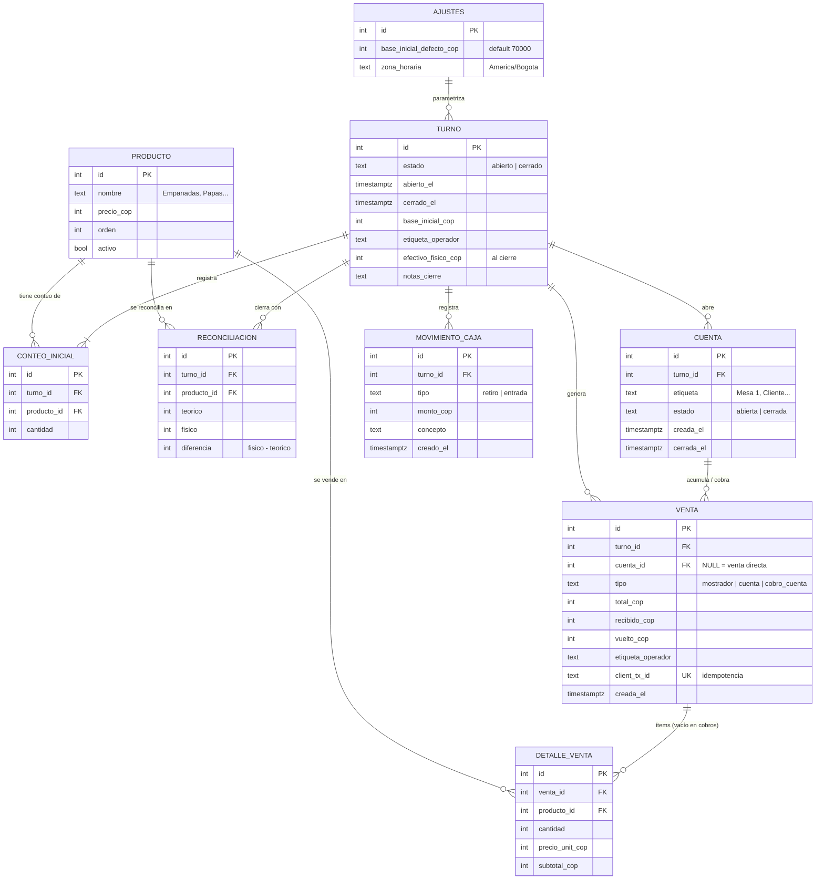

# MER Técnico — Sistema de Gestión Fritanga

> Modelo Entidad-Relación para PostgreSQL (Supabase). Todo en español.
> Versión no técnica para el dueño del negocio: [`mer-visual.md`](./mer-visual.md)

---

## 1. Diagrama entidad-relación



---

## 2. Diccionario de atributos

| Entidad | Atributo | Tipo | Descripción / restricción |
|---|---|---|---|
| **AJUSTES** | `id` | int PK | Fila única (= 1) |
| | `base_inicial_defecto_cop` | int | Default **70000** (RF1) |
| | `zona_horaria` | text | `America/Bogota` — corte de día del negocio |
| **PRODUCTO** | `id` | int PK | |
| | `nombre` | text | Único donde `activo = true` |
| | `precio_cop` | int | COP enteros, **sin decimales** (RF4) |
| | `orden` | int | Orden en el grid de venta |
| | `activo` | bool | Desactivar sin borrar (histórico íntegro) |
| **TURNO** | `id` | int PK | |
| | `estado` | text | `abierto` \| `cerrado` |
| | `abierto_el` / `cerrado_el` | timestamptz | Marca de apertura y cierre |
| | `base_inicial_cop` | int | Se congela al abrir (RF1) |
| | `etiqueta_operador` | text | Quién abrió (texto libre, sin login) |
| | `efectivo_fisico_cop` | int NULL | Conteo físico del dinero, solo al cierre (RF5) |
| | `notas_cierre` | text | Observaciones del cierre |
| **CONTEO_INICIAL** | `turno_id` | int FK → turno | |
| | `producto_id` | int FK → producto | |
| | `cantidad` | int | Stock real de arranque por producto (RF2) |
| | | | **UNIQUE(turno_id, producto_id)** |
| **CUENTA** | `turno_id` | int FK → turno | |
| | `etiqueta` | text | "Mesa 1", "Cliente con chaqueta" (RF3) |
| | `estado` | text | `abierta` \| `cerrada` |
| | | | **UNIQUE parcial: una sola cuenta *abierta* por etiqueta y turno** (índice `WHERE estado='abierta'`) |
| **VENTA** | `turno_id` | int FK → turno | |
| | `cuenta_id` | int FK → cuenta NULL | NULL = venta directa en mostrador; con valor = ítem de cuenta o cobro |
| | `tipo` | text | `mostrador` (venta directa con efectivo) \| `cuenta` (ítem acumulado a cuenta, sin cobrar) \| `cobro_cuenta` (pago final de la cuenta, sin ítems) |
| | `total_cop` | int | Suma de los ítems |
| | `recibido_cop` / `vuelto_cop` | int | Vuelto = recibido − total (RF4) |
| | `etiqueta_operador` | text | Quién registró la venta |
| | `client_tx_id` | text **UNIQUE** | UUID del cliente → **idempotencia**: un reintento de red no duplica la venta |
| **DETALLE_VENTA** | `venta_id` | int FK → venta | |
| | `producto_id` | int FK → producto | |
| | `cantidad` | int | Unidades vendidas |
| | `precio_unit_cop` | int | Precio **copiado** en el ítem: si mañana cambia el catálogo, la historia no se altera |
| | `subtotal_cop` | int | cantidad × precio_unit |
| **MOVIMIENTO_CAJA** | `turno_id` | int FK → turno | |
| | `tipo` | text | `retiro` \| `entrada` |
| | `monto_cop` | int | Valor del movimiento (RF5) |
| | `concepto` | text | Motivo ("cambio a banco", "compra de gas") |
| **RECONCILIACION** | `turno_id` | int FK → turno | |
| | `producto_id` | int FK → producto | |
| | `teorico` | int | Stock derivado: inicial − vendidos |
| | `fisico` | int | Conteo real hecho a mano |
| | `diferencia` | int | físico − teórico (negativo = merma) |
| | | | **UNIQUE(turno_id, producto_id)** |

---

## 3. Reglas de integridad y cardinalidades

```
AJUSTES    1 ──── 0..N  TURNO            (parámetros de apertura)
PRODUCTO   1 ──── 1..N  CONTEO_INICIAL   (por turno, carga inicial RF2)
PRODUCTO   1 ──── 0..N  DETALLE_VENTA
PRODUCTO   1 ──── 1..N  RECONCILIACION   (por turno cerrado)
TURNO      1 ──── 1..N  CONTEO_INICIAL
TURNO      1 ──── 0..N  VENTA
TURNO      1 ──── 0..N  CUENTA           (cuentas abiertas RF3)
TURNO      1 ──── 0..N  MOVIMIENTO_CAJA
TURNO      1 ──── 1..N  RECONCILIACION
CUENTA     1 ──── 0..N  VENTA            (acumula ítems; la última = cobro final)
VENTA      1 ──── 0..N  DETALLE_VENTA   (las ventas tipo cobro_cuenta no llevan ítems)
```

### Reglas de negocio aplicadas en la base de datos

1. **Solo 1 turno `abierto` a la vez** → índice único parcial `WHERE estado='abierto'`.
2. **El stock teórico NO es columna** — se deriva:
   `stock_teorico(turno, producto) = conteo_inicial.cantidad − Σ detalle_venta.cantidad`
   (garantiza que jamás se desincronice; el cálculo vive en la RPC, no en el cliente).
3. **Todo cambio de inventario pasa por RPC transaccional** (bloqueo de filas `FOR UPDATE`), nunca `UPDATE` directo desde la app.
4. **Siempre existe una `RECONCILIACION` por producto al cerrar turno** → `fn_cerrar_turno` la inserta en la misma transacción que cierra.
5. **Borrados:** nunca `DELETE` de ventas o turnos desde la app → solo `PRODUCTO.activo = false` (histórico íntegro).
6. **Clave ajena opcional:** `VENTA.cuenta_id` NULL = venta directa en mostrador; con valor = acumulado o cobro de cuenta.

---

## 4. Atributos derivados (calculados, nunca almacenados)

```
Stock teórico       = Inicial − Vendidos                                    (RF2)
Dinero Esperado     = base_inicial + Σ ventas en efectivo − Σ retiros + Σ entradas   (RF5)
Diferencia de caja  = efectivo_fisico − Dinero Esperado
Merma de producto   = físico − teórico   (negativo = merma)
Total de cuenta     = Σ ventas asociadas a la cuenta
```

> **Σ ventas en efectivo** = `SUM(total_cop) WHERE tipo IN ('mostrador','cobro_cuenta')` **del turno**, porque ambas representan dinero que entró al caja.

---

## 5. Tablas derivadas / apoyo (no son entidades)

| Objeto | Tipo | Propósito |
|---|---|---|
| `v_reporte_turno` | Vista | Ventas por producto, totales en efectivo, retiros, mermas y diferencia de un turno — una sola consulta para la pantalla de cierre |
| `stock_teorico` | Función/vista | Cálculo en vivo de inventario disponible por producto en el turno abierto |
