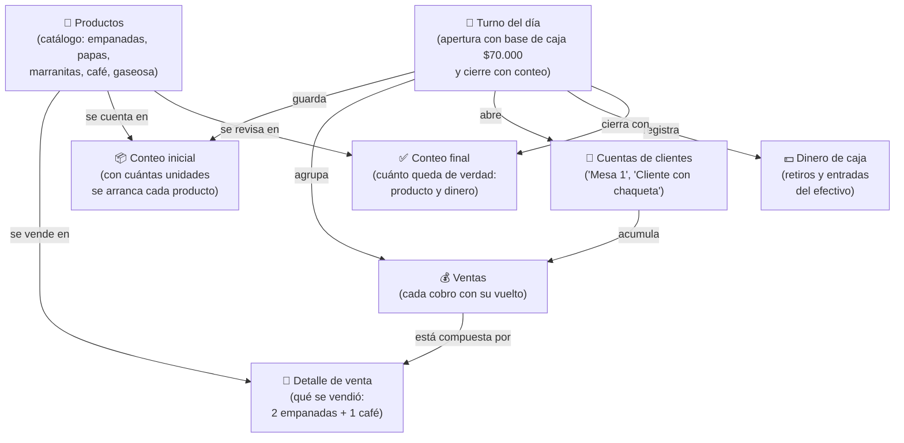

# MER Visual — Sistema de Gestión Fritanga

> **Versión para el dueño del negocio:** sin tecnicismos.
> Explica qué datos guarda el sistema y cómo se conectan entre sí.
> Versión técnica para desarrollo: [`mer-tecnico.md`](./mer-tecnico.md)

---

## 1. ¿Cómo se conecta la información?



---

## 2. Qué significa cada cosa

| Caja | Qué es en la fritanga |
|---|---|
| 🍟 **Productos** | La lista de lo que se vende y su precio. Se edita una vez y listo. |
| 📅 **Turno del día** | La jornada: quién abrió, con cuánta plata de cambio se arrancó (los $70.000) y cuándo se cerró. |
| 📦 **Conteo inicial** | "Hoy arranco con 100 empanadas, 50 marranitas, 80 café…" — lo que hay en la mañana. |
| 🧾 **Cuentas de clientes** | Las pestañas abiertas por cliente o mesa, que van sumando lo que consumen hasta que pagan. |
| 💰 **Ventas** | Cada cobro: cuánto fue, cuánto dio el cliente y cuánto fue el vuelto. |
| 🛒 **Detalle de venta** | El ticket por dentro: "2 empanadas + 1 café con leche". |
| 💵 **Dinero de caja** | Las veces que se sacó o entró dinero (ej. "sacé $20.000 para el banco"). |
| ✅ **Conteo final** | Al cerrar: se cuenta a mano lo que queda y el sistema compara con lo que **debía** quedar → eso es la **merma** o la **diferencia**. |

---

## 3. Reglas sencillas (contadas sin técnica)

1. **Solo un turno a la vez.** No se puede abrir la caja del día si ya hay una abierta.
2. **Cada venta baja el inventario al instante** en los 3 dispositivos — nadie puede vender la última empanada dos veces.
3. **El sistema nunca "adivina":** siempre guarda lo que se contó al empezar y lo que se contó al terminar, y hace la resta.
4. **Las cuentas abiertas suman todo** hasta que el cliente paga; al cobrar, esa venta ya cuenta como dinero en caja.
5. **Nada se borra:** si un producto se deja de vender, se apaga, pero el histórico de ventas queda intacto.

---

## 4. Ejemplo del día a día

```
Mañana (8:00)
  → Se abre el turno: base de caja $70.000
  → Conteo inicial: 100 empanadas, 60 papas rellenas, ...

Mediodía (12:30) — hora pico
  → Mesa 1 abre una cuenta: "2 empanadas"
  → El mismo cliente después pide: "1 café con leche"  (se acumula)
  → Otro cliente paga en mostrador: 1 marranita con $5.000 → vuelto $3.000
  → Los 3 dispositivos ven el inventario bajar al instante.

Cierre (6:00)
  → Se cuentan las empanadas que quedan: quedaron 12
  → El sistema decía que debían quedar 14  →  MERMA de 2
  → Se cuenta el dinero en caja:
        Esperado = $70.000 (base) + ventas en efectivo − retiros + entradas
        Real     = lo que se contó
        → Diferencia (faltante o sobrante)
```
